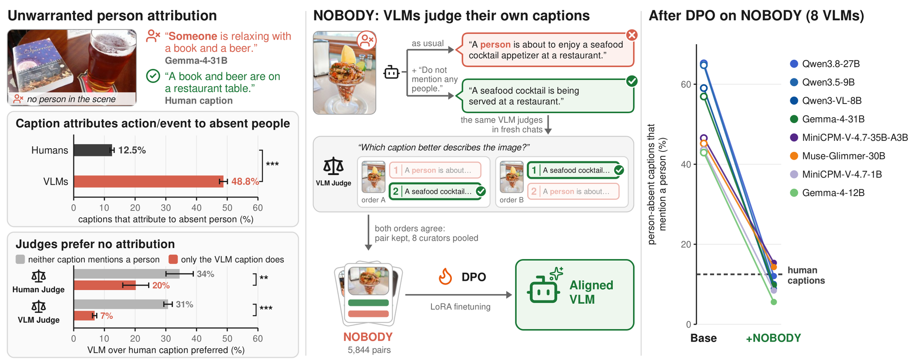

<p align="center"></p>

<h1 align="center">NOBODY Was There</h1>
<p align="center"><b>Bridging the Human–VLM Gap in Unwarranted Person Attribution</b></p>

<p align="center">
  <a href="https://pmadinei.github.io/NOBODY">Project page</a> ·
  <a href="https://huggingface.co/datasets/pmadinei/NOBODY">NOBODY dataset</a> ·
  <a href="https://huggingface.co/datasets/pmadinei/NOBODY-Bench">NOBODY-Bench</a> ·
  Paper (arXiv link coming soon)
</p>

<p align="center"></p>

Vision-language models attribute scenes to people who are not there: asked what might be happening in a photo of a
book and a pint on a table, a VLM often answers "Someone is relaxing with a book and a beer". Across 22 open VLMs,
captions of person-absent scenes mention a person four times as often as human captions of the same images, and
human and VLM judges both prefer captions without such attributions.

This repository holds

* **NOBODY** (`dataset/`): 5,844 preference pairs for aligning VLMs with direct preference optimization. Eight
  VLMs captioned photographs twice, as usual and under "Do not mention any people.", and judged their own two
  captions in both orders.
* **NOBODY-Bench** (`benchmark/`): an evaluation of any VLM's agreement with human captions (PAMA, PPMA) and human
  judges (PJA) on person attribution.
* the [project page](https://pmadinei.github.io/NOBODY) (`docs/`).

## Evaluate a VLM on NOBODY-Bench

```bash
git clone https://github.com/pmadinei/NOBODY.git && cd NOBODY/benchmark
pip install -r ../requirements.txt
# images (5,239 files, 2.4 GB) come from the Hugging Face repository
huggingface-cli download pmadinei/NOBODY-Bench --repo-type dataset --include "images/*" --local-dir .

# caption every image and score the captions, with one of three backends
python caption.py --backend transformers --model Qwen/Qwen3-VL-8B-Instruct          # Hugging Face transformers
python caption.py --backend vllm --model Qwen/Qwen3-VL-8B-Instruct [--lora ADAPTER]  # vLLM, batched
python caption.py --backend openai --model MODEL [--base-url URL]                    # any OpenAI-compatible API

# or score captions you already have (CSV with the columns id,caption)
python evaluate.py --captions my_model.csv --out my_model.json
```

Every image gets a fresh chat with the benchmark prompt and greedy decoding. `caption.py` writes
`captions/<name>.csv` and `results/<name>.json` and resumes an interrupted run; `--limit 20` runs a smoke test.
Scoring is text-only and takes seconds on a CPU.

```
NOBODY-Bench  |  Qwen3.5-9B
measure    model   95% CI           human captions
PAMA        42.3   [37.2, 47.8]           82.8
PPMA        94.7   [93.4, 95.9]           93.1
PJA         72.3   [70.9, 73.6]             --
APM         64.8   [58.3, 70.7]           12.5
VPR         96.3   [94.8, 97.7]           93.1
```

### Measures

Let `m` be 1 if a caption mentions a person (`person_lexicon.py`) and `h` the share of the image's human captions
that mention one. The agreement `m*h + (1-m)*(1-h)` is the probability that a randomly drawn human caption of the
image makes the same decision.

| measure | definition | human captions |
|---|---|---|
| **PAMA** (Person-Absent Mention Agreement) | mean agreement over the 664 images without a visible person | 82.8% |
| **PPMA** (Person-Present Mention Agreement) | mean agreement over the 949 images with a visible person | 93.1% |
| **PJA** (Public-Judge Agreement) | human judges of four public preference datasets preferred a response without a person on set A and with a person on set B; PJA is the mean of the model's person-mention rate on B and one minus its rate on A | -- |

Higher is better. Read PAMA and PPMA together: a model that never mentions people reaches 87.5% PAMA but only 6.9%
PPMA.

### Reference results

Greedy captions; "+ NOBODY" is the same model after DPO on NOBODY. Curators contributed pairs to NOBODY; held-out
models did not. Full table: [`benchmark/reference_results.csv`](benchmark/reference_results.csv).

| model | role | PAMA base | PAMA + NOBODY | PPMA base | PPMA + NOBODY | PJA base | PJA + NOBODY |
|---|---|---|---|---|---|---|---|
| *Human captions* | | *82.8* | | *93.1* | | -- | |
| Qwen3-VL-8B | curator | 46.6 | **86.3** | 94.6 | **94.0** | 70.7 | **82.5** |
| Qwen3.5-9B | curator | 42.3 | **85.1** | 94.7 | **94.8** | 72.3 | **83.6** |
| Qwen3.8-27B | curator | 42.8 | **83.7** | 94.3 | **95.0** | 75.3 | **83.7** |
| Gemma-4-12B | curator | 59.1 | **87.8** | 95.5 | **94.6** | 78.0 | **83.8** |
| Gemma-4-31B | curator | 48.4 | **85.5** | 94.8 | **95.1** | 75.8 | **83.8** |
| Muse-Glimmer-30B | curator | 58.6 | **82.0** | 92.1 | **93.0** | 76.1 | **81.8** |
| MiniCPM-V-4.7-35B-A3B | curator | 58.3 | **82.0** | 95.0 | **94.7** | 77.2 | **82.5** |
| MiniCPM-V-4.7-1B | curator | 58.9 | **85.8** | 94.3 | **94.7** | 76.9 | **82.5** |
| Qwen3.5-0.8B | held-out | 50.4 | **86.8** | 95.2 | **94.5** | 72.7 | **83.0** |
| Qwen3.5-2B | held-out | 53.9 | **86.1** | 94.7 | **94.3** | 71.9 | **82.5** |
| Qwen3.5-4B | held-out | 45.8 | **73.6** | 94.8 | **94.6** | 73.9 | **81.6** |
| Qwen3.5-27B | held-out | 54.4 | **85.3** | 94.2 | **94.2** | 76.7 | **83.3** |
| InternVL3.5-1B | held-out | 45.4 | **86.2** | 95.0 | **95.5** | 72.4 | **82.9** |
| Qwen3-VL-2B | held-out | 57.7 | **87.3** | 94.6 | **94.3** | 77.0 | **84.4** |
| SmolVLM2-2.2B | held-out | 62.6 | **87.3** | 95.4 | **95.7** | 80.6 | **85.2** |
| Qwen2.5-VL-3B | held-out | 70.2 | **86.7** | 94.9 | **93.8** | 84.2 | **85.8** |
| Qwen3-VL-4B | held-out | 43.3 | **84.0** | 94.6 | **94.7** | 69.4 | **81.9** |
| Qwen2.5-VL-7B | held-out | 67.1 | **87.6** | 95.1 | **95.1** | 80.4 | **84.4** |
| LLaVA-OneVision-7B | held-out | 57.7 | **86.7** | 94.9 | **95.2** | 80.7 | **85.5** |
| Idefics3-8B | held-out | 78.2 | **85.3** | 93.3 | **94.2** | 82.5 | **85.2** |
| InternVL3.5-14B | held-out | 63.9 | **78.0** | 95.3 | **95.1** | 77.8 | **82.3** |
| Mistral-Small-3.1-24B | held-out | 49.9 | **84.8** | 94.6 | **94.6** | 73.8 | **82.8** |

## Use the NOBODY dataset

```python
from datasets import load_dataset
ds = load_dataset("pmadinei/NOBODY")        # train / validation; chosen and rejected captions, V3Det image ids
```

`dataset/nobody.json` holds the same pairs. The images are V3Det photographs and are not redistributed;
`python dataset/get_images.py --v3det-root /path/to/V3Det` copies them into `dataset/images/`. The paper aligns
VLMs with DPO: LoRA (rank 16, alpha 32) on the language model, beta 0.1, learning rate 5e-6, batches of 32 pairs,
one epoch.

## Repository layout

| path | content |
|---|---|
| `benchmark/nobody_bench.json` | benchmark annotations: images, human captions, public-judge sets, human preference study |
| `benchmark/evaluate.py`, `caption.py`, `person_lexicon.py` | scoring, captioning, person-mention lexicon |
| `benchmark/reference_results.csv` | scores of 22 VLMs before and after alignment |
| `dataset/nobody.json`, `dataset/get_images.py` | NOBODY pairs, image retrieval from V3Det |
| `docs/` | project page |

Participant and captioner identifiers in the released data are random ids created for the release.

## Citation

If you use NOBODY or NOBODY-Bench, please cite our paper:

```bibtex
@article{madinei2026nobody,
  title   = {NOBODY Was There: Bridging the Human--VLM Gap in Unwarranted Person Attribution},
  author  = {Madinei, Parsa and others},
  journal = {arXiv preprint arXiv:XXXX.XXXXX},
  year    = {2026}
}
```
